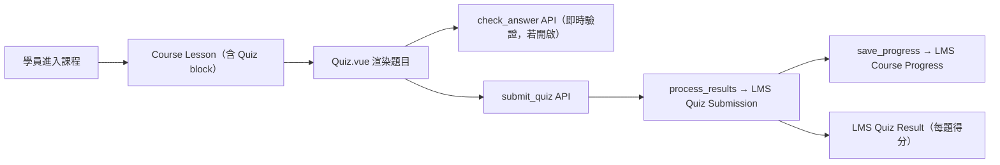
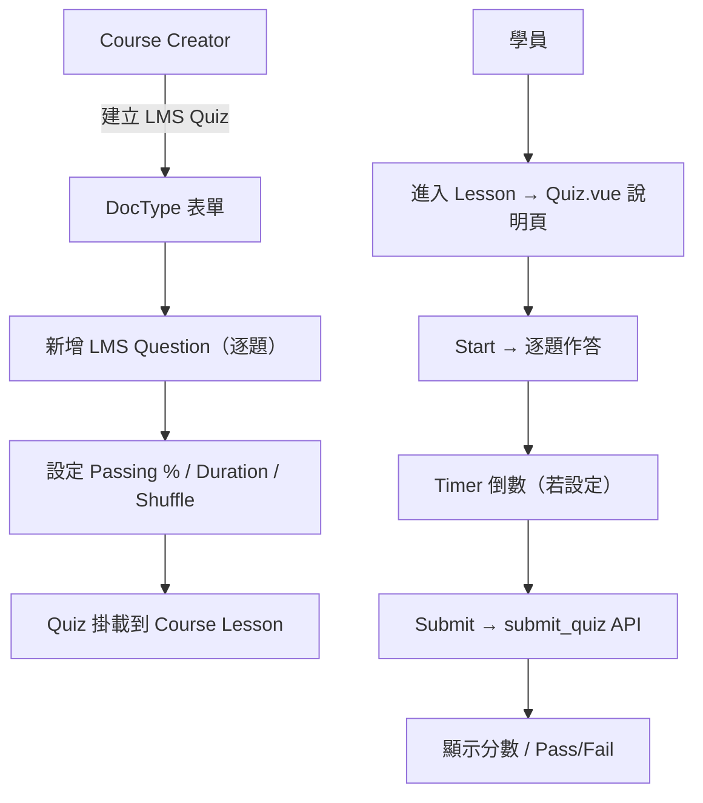

# frappe/lms

$$\text{Repo} = \text{LMS}(\text{課程/Quiz 骨幹}) + \text{Vue.js}(\text{前端}) + \text{Frappe}(\text{框架}) + \text{AGPL-3.0}(\text{License 約束})$$

## 3W 定位

$$\text{3W} = \begin{cases}
What & \text{Frappe Framework 官方 LMS：課程/章節/測驗三層結構 + 付費/批次管理} \\
Why & \text{企業內訓/線上教育：從零建置成本高，套用現成 LMS 節省 50\%+ 工時} \\
How & \text{Python DocType（後端）+ Vue.js（frappe-ui 前端）+ Frappe Whitelist API（前後端橋接）}
\end{cases}$$

**App 元數據（hooks.py）：**
- `app_name = "frappe_lms"`（pip 安裝名稱）
- `required_apps = ["frappe/payments"]`（必須同時安裝 payments app）
- License: AGPL-3.0（**商用部署須 source code 公開或付費授權**）

---

## 場景與市場

$$\text{Market} = \text{Frappe/ERPNext 生態企業} + \text{線上課程平台} + \text{技術訓練中心}$$

| 場景 | 適配度 | 說明 |
|------|:------:|------|
| 結構課程（影片+測驗） | ⭐⭐⭐⭐⭐ | 核心設計場景 |
| 正式計時考試 | ⭐⭐⭐⭐ | Duration + Max Attempts 支援 |
| 批次班級管理 | ⭐⭐⭐⭐⭐ | LMS Batch 完整實作 |
| 付費課程/訂閱 | ⭐⭐⭐⭐ | Razorpay 整合，需 payments app |
| 刷題/練習模式 | ⭐ | **不支援（缺口）** |
| 排行榜/競賽 | ⭐ | **不支援（缺口）** |
| 題庫專屬批量匯入 | ⭐⭐ | 僅 Frappe 通用 CSV Data Import |

---

## 技術棧

$$\text{TechStack} = \text{Python 31\%} + \text{Vue.js 55\%（frappe-ui）} + \text{Frappe v16+}$$

| 層 | 技術 | 說明 |
|----|----|------|
| 後端框架 | Frappe Framework v16+ | DocType ORM + Whitelist API |
| 前端框架 | Vue.js 3 + frappe-ui | SPA，978 行 Quiz.vue |
| 支付 | Razorpay（required_apps: payments） | 付費課程必需 |
| 依賴 | markdown, beautifulsoup4, fuzzywuzzy, cairocffi | NLP/模糊匹配（答案比對） |
| SCORM | zipfile + XML 解析 | SCORM 2004 course import |

---

## 架構分析

$$\text{Architecture} = \text{DocType Layer}(\text{69 doctypes}) + \text{API Layer}(\text{lms.lms.api + 各 doctype controller}) + \text{Vue SPA}$$

### Quiz 子系統 DocType 關係

```
LMS Quiz                    ← 考卷設定（計時/及格/洗牌/負分）
  └─ LMS Quiz Question      ← Child Table（題目清單 + 分數）
       └─ LMS Question      ← 題目本體（Choices/User Input/Open Ended）
            └─ 4x option_N + is_correct_N  ← 固定 4 選項
            └─ 4x possibility_N            ← User Input 可接受答案

LMS Quiz Submission         ← 作答記錄
  └─ LMS Quiz Result        ← Child Table（每題答案 + 得分）
```

### 重要發現：`allow_import = 1`

$$\text{Key Insight}: \text{LMS Quiz} + \text{LMS Question} \xrightarrow{allow\_import=1} \text{Frappe Data Import（CSV/Excel）可用}$$

→ **Frappe 通用 Data Import 已可批量匯入題目**，但格式嚴格（需符合 DocType 欄位名稱），無用戶友善 XLSX 解析 UI。

### 課程 ZIP 匯出/匯入

```python
# course_import_export.py
def export_course_zip(course_name): ...  # 含 quiz + questions
def import_course_zip(zip_file): ...     # 完整還原
def get_quiz_questions(doc): ...         # 提取 LMS Question as_dict
```

→ 課程層級的整體匯出含 Quiz，但無「題庫獨立匯入」工具。

---

## 資料流程



---

## 使用者操作流程



---

## API 入口

$$\text{QuizAPI} = \{submit\_quiz,\; check\_answer,\; get\_question\_details\}$$

```python
# lms/lms/doctype/lms_quiz/lms_quiz.py

@frappe.whitelist()
def submit_quiz(quiz: str, results: str | None = None):
    """處理作答提交，計算分數，建立 LMS Quiz Submission"""
    # 回傳 {score, score_out_of, submission, pass, percentage}

@frappe.whitelist()
def check_answer(quiz: str, question: str, question_type: str, answers: str):
    """即時驗證答案（需 show_answers=1），支援 Choices / User Input"""

@frappe.whitelist()
def get_question_details(question: str):
    """取得題目選項詳情（前端用）"""
```

**前端呼叫路徑：**
```
lms.lms.doctype.lms_quiz.lms_quiz.submit_quiz
lms.lms.doctype.lms_quiz.lms_quiz.check_answer
```

**題型對應：**
| 題型 | type 值 | 評分方式 |
|------|---------|---------|
| 單選/多選 | `Choices` | is_correct_N 自動比對 |
| 填空 | `User Input` | fuzzywuzzy 模糊匹配 possibility_N |
| 開放式 | `Open Ended` | 標記 is_open_ended，手動評分 |

---

## 交叉比對

$$\text{Relation} = \text{QuizForge-AI}(\text{需求方}) \xrightarrow{\text{套用 55\%}} \text{frappe/lms} + \text{需自開發 45\%}$$

| QuizForge-AI 功能 | frappe/lms 狀態 | 備註 |
|-----------------|:--------------:|------|
| 題庫匯入 XLSX | ⚠️ 通用 CSV | 需開發專屬解析 UI |
| 多題型（MC/TF/填空）| ⚠️ MC+填空有 | TF 無獨立題型 |
| 計時考試 | ✅ | Duration 欄位 |
| 自動評分 | ✅ | submit_quiz() |
| 刷題/錯題模式 | ❌ | 全缺，須自行開發 |
| 排行榜 | ❌ | 全缺，須自行開發 |
| AI 出題整合 | ❌ | 須接 Claude API |

---

## 競品比較

| App | Quiz | Import | 排行榜 | License | Fork 難度 |
|-----|:----:|:------:|:------:|---------|:--------:|
| **frappe/lms** | ✅ 完整 | ⚠️ 通用 CSV | ❌ | AGPL-3.0 | 中高 |
| lebmatter/exampro | ✅ 監考強 | ❌ | ❌ | MIT | 中 |
| frappe/education | ❌ | N/A | ❌ | AGPL-3.0 | 不適用 |

---

## 採用決策

$$\text{Decision} = \begin{cases}
\text{採用策略} & \text{安裝 frappe/lms 作為基礎骨幹（不 Fork，以 Custom App 擴充）} \\
\text{理由} & \text{AGPL-3.0 下 Fork 商用有法律風險；Custom App 隔離更安全} \\
\text{替代方案} & \text{從零開發：工時 3× 以上，不推薦} \\
\text{License 注意} & \text{AGPL-3.0：若對外提供 SaaS 服務，須公開修改後代碼}
\end{cases}$$

### Fork 難度評估：**中高（6/10）**

$$\text{ForkDifficulty} = \begin{cases}
\text{後端 DocType} & \text{易擴充（Child Table / Custom Field 即可）} \\
\text{前端 Vue SPA} & \text{複雜（978 行 Quiz.vue + frappe-ui 元件依賴）} \\
\text{required\_apps: payments} & \text{必須同裝 payments，增加部署複雜度} \\
\text{AGPL 授權} & \text{商用部署需謹慎（推薦 Custom App 而非 Fork）} \\
\text{69 DocTypes} & \text{大型 app，理解成本高但結構清晰}
\end{cases}$$

### 推薦執行路徑

```
bench get-app frappe/lms
bench install-app lms
# → 取得 Quiz DocType + Vue 前端骨幹

bench new-app quizforge
# → Custom App：開發題庫匯入 / 刷題 / 排行榜 三大缺口
# → frappe-api-design 規範 Claude API 整合
```

**結論：** frappe/lms 是 QuizForge 轉型 Frappe 架構的最佳起點。以 Custom App 方式擴充比 Fork 更符合 AGPL 合規要求，且維護成本更低。`allow_import=1` 提供基礎題目匯入能力，仍需開發 XLSX 解析 UI 提升用戶體驗。
